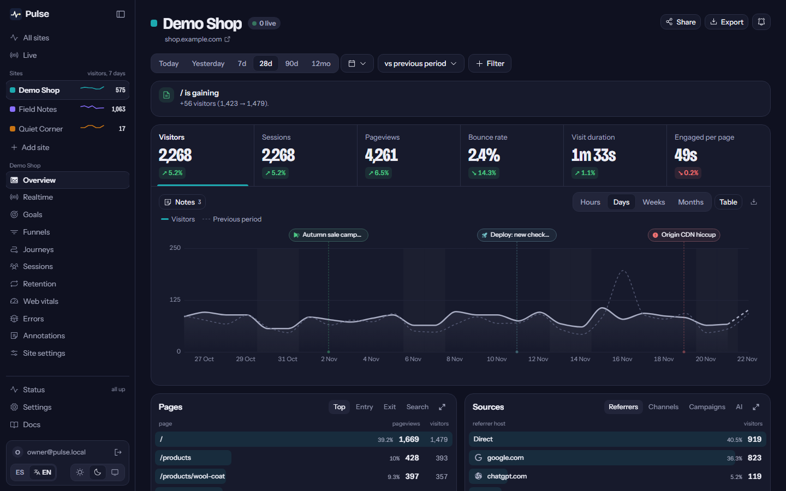
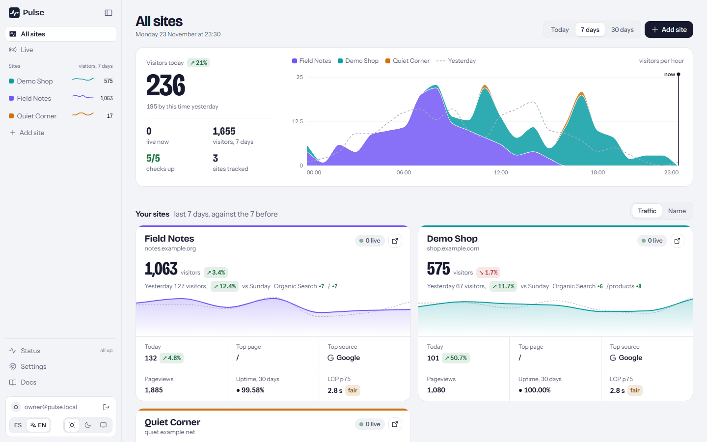
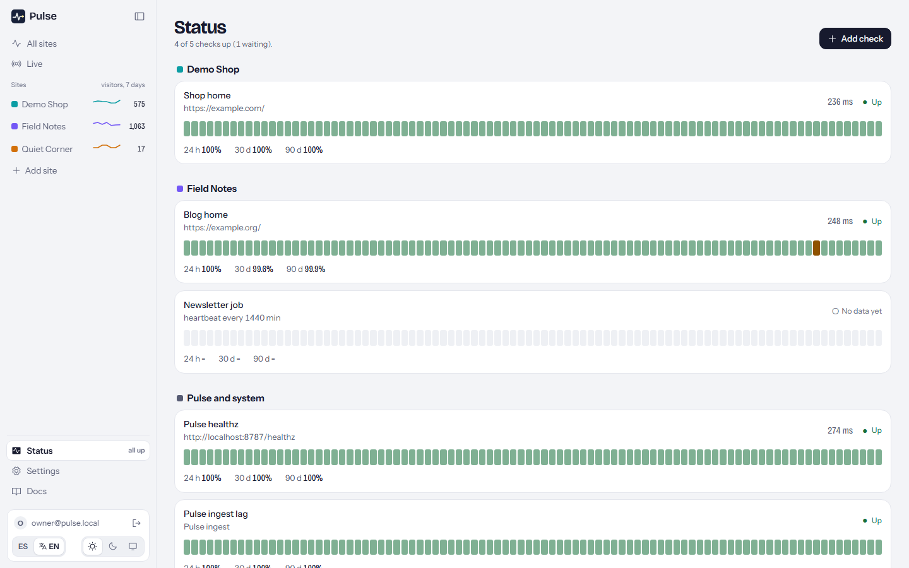
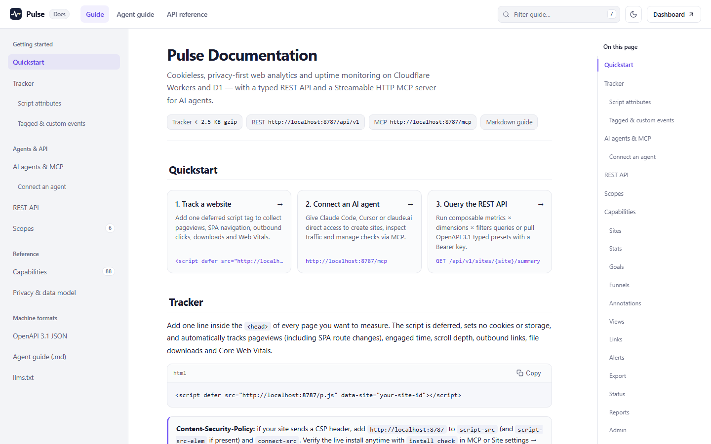
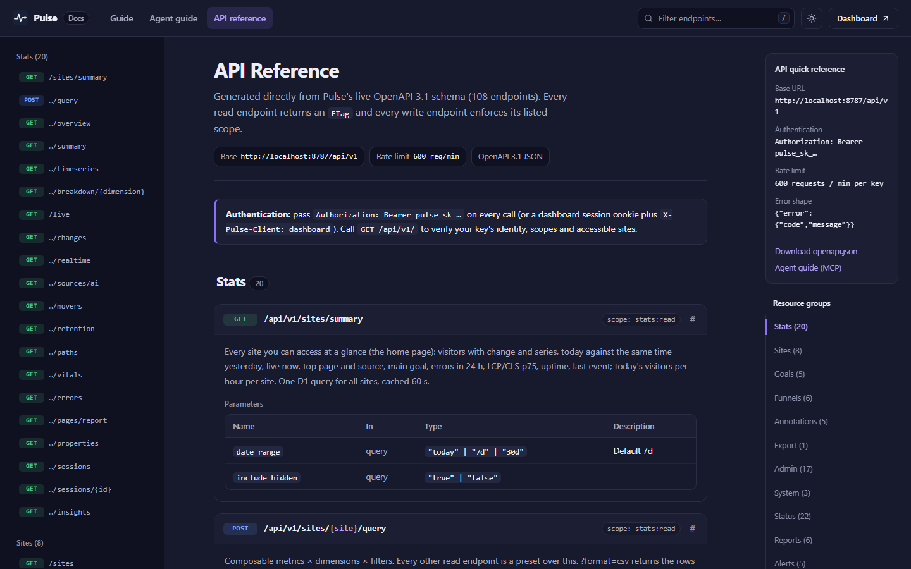
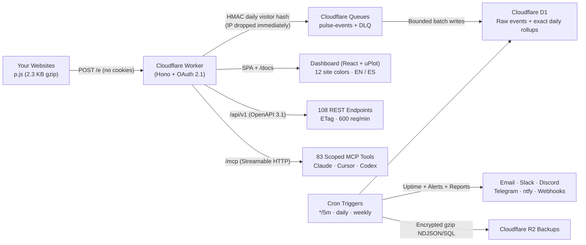

<div align="center">


# Pulse Analytics for Cloudflare

**Private, cookieless web analytics, uptime monitoring, REST API, and an 83-tool MCP server — running on a single Cloudflare Worker + D1.**

No cookie banners. No third-party data brokers. No per-pageview SaaS tiers. Just one edge deployment you own.

<p>
  <a href="https://deploy.workers.cloudflare.com/?url=https://github.com/pablobravo44/pulse-analytics-cloudflare">
    
  </a>
</p>

<p>
  <a href="https://pablobravo44.github.io/pulse-analytics-cloudflare/"></a>
  <a href="https://github.com/pablobravo44/pulse-analytics-cloudflare/actions/workflows/ci.yml"></a>
  <a href="LICENSE"></a>
  
  
  
</p>

<p>
  <a href="https://pablobravo44.github.io/pulse-analytics-cloudflare/"><strong>Website</strong></a> ·
  <a href="https://pablobravo44.github.io/pulse-analytics-cloudflare/docs.html"><strong>Documentation (EN / ES)</strong></a> ·
  <a href="#install--deploy"><strong>Install</strong></a> ·
  <a href="#deploy-with-an-ai-agent"><strong>Deploy with AI Agent</strong></a> ·
  <a href="docs/MCP.md"><strong>MCP Reference</strong></a> ·
  <a href="docs/API.md"><strong>REST API</strong></a>
</p>

</div>

---

<p align="center">
  
</p>

<details>
<summary><strong>More screenshots</strong> — Multi-site home, Uptime status board, and Built-in OpenAPI 3.1 docs</summary>

<br />

| All Sites Overview (Light) | Uptime Status & 90-day Bars |
|---|---|
|  |  |

| Built-in Technical Docs (`/docs`) | Generated OpenAPI 3.1 Reference (`/docs/api`) |
|---|---|
|  |  |

</details>

---

## Why Pulse?

Most self-hosted analytics stacks require managing Postgres or ClickHouse containers, reverse proxies, cron workers, and a separate uptime monitor — and still leave AI coding agents blind to live traffic. Pulse collapses the entire stack onto **Cloudflare Workers + D1 + Queues + R2**, designed from day one for both humans and AI agents.

| Capability | Pulse | Google Analytics 4 | Plausible / Umami Cloud | Typical Self-Hosted Stack |
|---|:---:|:---:|:---:|:---:|
| **Cookieless (no cookie banner)** | Yes (`0` cookies) | No | Yes | Varies |
| **Tracker footprint (gzip)** | **2.3 KB** | ~45+ KB | 1–3 KB | 2–10 KB |
| **Native MCP Server (OAuth 2.1 + API keys)** | **83 scoped tools** | No | No | No |
| **Built-in Uptime Monitoring & Alerts** | **7 check kinds** | No | No | Separate tool |
| **Deploy / Campaign Chart Annotations** | **Native + CI webhook** | Manual | Basic | Varies |
| **Typed OpenAPI 3.1 REST API** | **108 endpoints** | Complex | Limited | Partial |
| **12 Site Signal Colors + EN/ES UI** | Yes | No | No | No |
| **Infrastructure & Monthly Cost** | **Cloudflare Workers Paid ($5 flat)** | Free (data sold) | $9–$90+/mo | VPS + DB maintenance |

---

## Install & Deploy

> **Requirement:** A Cloudflare account on **Workers Paid ($5/month)** — required for Cloudflare Queues (the ingest buffer) and 5-minute CPU limits on backup jobs. Full guides live on the [Documentation website](https://pablobravo44.github.io/pulse-analytics-cloudflare/docs.html).

### Option 1 — 1-Click Deploy to Cloudflare (Fastest)

<p>
  <a href="https://deploy.workers.cloudflare.com/?url=https://github.com/pablobravo44/pulse-analytics-cloudflare">
    
  </a>
</p>

1. Click **Deploy to Cloudflare** above. Cloudflare clones this repo, automatically provisions **D1**, **Queues**, **KV**, and **R2**, applies SQL migrations, builds the dashboard & tracker, and deploys Pulse to `https://pulse.<your-subdomain>.workers.dev`.
2. Verify it's live: open `https://pulse.<your-subdomain>.workers.dev/healthz` and `/docs`.
3. **Access your instance:**
   - **API & MCP (works immediately):** clone your fork locally and mint a scoped API key (`npm run admin -- key:create --name agent --scopes stats:read,sites:write,ops:write,annotations:write` — written to git-ignored `.data/keys.env`).
   - **Web Dashboard sign-in:** configure a free Cloudflare Access app guarding `/auth/access` (30-second setup in Zero Trust), set `ACCESS_EMAILS` via `npx wrangler secret put ACCESS_EMAILS`, and sign in with a one-time email code. See [docs/SELF-HOSTING.md](docs/SELF-HOSTING.md#3-sign-in-with-cloudflare-access).

---

### Option 2 — Deploy with an AI Agent (1 Prompt)

Point **Claude Code**, **Codex**, or **Cursor** at this repository with a single prompt. Every step — Cloudflare resource creation, deploy, secret piping, MCP setup, adding `<script defer src="…/p.js">` to your repos, updating CSP headers, verifying with `install_check`, and creating uptime monitors — is scripted in **[docs/AGENT-SETUP.md](docs/AGENT-SETUP.md)**.

```text
Follow docs/AGENT-SETUP.md in this repo to deploy Pulse to my Cloudflare account
at pulse.yourdomain.com (EU jurisdiction), connect Pulse MCP, and install + verify
tracking and an uptime check for my websites: yourdomain.com (repo at ../my-site).
```

<details>
<summary><strong>Prompt en Español</strong></summary>

```text
Sigue docs/AGENT-SETUP.md en este repo para desplegar Pulse en mi cuenta de Cloudflare
en pulse.tudominio.com (jurisdicción EU), conectar el servidor MCP de Pulse, e instalar y
verificar el tracker y una comprobación de disponibilidad en mis webs: tudominio.com
(repo en ../mi-web).
```

</details>

---

### Option 3 — Custom Domain & EU-Pinned CLI Deploy

For a dedicated hostname (`pulse.yourdomain.com`), EU-pinned D1/R2 storage, and Cloudflare Email Routing alerts:

```bash
git clone https://github.com/pablobravo44/pulse-analytics-cloudflare.git
cd pulse-analytics-cloudflare
npm ci
npx wrangler login
cp .env.deploy.example .env.deploy    # fill PULSE_DOMAIN, PULSE_D1_ID, PULSE_KV_ID
npm run build
npm run deploy:custom
```

Full walkthrough in **[docs/SELF-HOSTING.md](docs/SELF-HOSTING.md)**.

---

### Try Locally in 30 Seconds (No Cloudflare Account Needed)

Run the real Worker in Node (`node:sqlite` + seeded 120-day demo traffic, including Windows):

```bash
git clone https://github.com/pablobravo44/pulse-analytics-cloudflare.git
cd pulse-analytics-cloudflare
npm ci
npm run build
npm run dev:seed
npm run dev
```

Open **`http://localhost:8787/__dev/login`** for an instant local owner session (dashboard on `:8787` or Vite HMR on `:5173`, built-in docs at `/docs`, `/docs/agents`, and `/docs/api`).

---

## Architecture

Everything runs inside **one Cloudflare Worker** — zero external databases, zero external font requests, zero third-party favicon proxies.



---

## What's Included

### Cookieless Web Analytics
- **2.3 KB gzipped tracker (`p.js`)**: pageviews (including SPA History navigation), engaged time, scroll depth, outbound links, file downloads, Core Web Vitals (`LCP`, `INP`, `CLS`), optional JS error + unhandled rejection capture (`data-errors="true"`), and no-JS form/button event tagging (`data-pulse-event="signup"`).
- **Exact daily rollups**: overview queries answer in **one D1 round trip** while matching raw-event numbers exactly across midnight boundaries (verified by 220+ randomized rollup-vs-raw tests).
- **Rich analysis views**: multi-site stacked river chart, real-time live visitors, goals & revenue attribution, strict/flexible funnels with breakdowns, user journeys, retention cohorts, anonymous same-day sessions, top movers, automated insights, and CSV/NDJSON export.
- **Redesigned chart annotations**: mark deploys, campaigns, incidents, or data-quality boundaries directly on timeseries charts (or automatically from CI via `POST /api/v1/hooks/deploy`).
- **12 WCAG-validated site colors**: `violet`, `teal`, `amber`, `magenta`, `blue`, `olive`, `coral`, `indigo`, `emerald`, `plum`, `cyan`, and `slate` in light & dark modes.

### Uptime Monitoring, Alerts & Reports
- **7 monitor types**: HTTP status/keyword, JSON path assertions, cron heartbeats (`/hb/:token`), read-only D1 SQL queries, adaptive ingest-lag checks, DNS records, and domain expiry.
- **90-day uptime bars**, quiet hours, incident acknowledgement, and **5 traffic alert rules** (`above`, `below`, `change_pct`, `no_data`, `event`, `new_error`).
- **6 notification channels**: Cloudflare Email Routing, Slack, Discord, Telegram, ntfy, and HMAC-signed webhooks (secrets encrypted at rest with `PULSE_SECRET_KEY`).
- **Scheduled weekly/monthly digests** with live HTML preview.

### Native MCP Server & OpenAPI 3.1 REST API
- **83 MCP tools** over Streamable HTTP (`/mcp`) with **least-privilege scopes** (`stats:read`, `events:export`, `annotations:write`, `sites:write`, `ops:write`, `admin`) and per-site boundaries.
- **Prompt-injection hardened**: API keys can never be minted or rotated over MCP; destructive purges require dry-run confirmation tokens or explicit site IDs.
- **Connect any agent in seconds:**

```bash
# Claude Code
claude mcp add --transport http pulse https://pulse.yourdomain.com/mcp \
  --header "Authorization: Bearer $PULSE_KEY"

# Codex CLI
codex mcp add pulse --url https://pulse.yourdomain.com/mcp --bearer-token-env-var PULSE_KEY
```

Or add `https://pulse.yourdomain.com/mcp` as a custom connector in **claude.ai / Claude Desktop** (OAuth 2.1 with per-site consent).

### Privacy Invariants (Enforced by Tests)
- **Zero cookies or browser storage** (except explicit visitor opt-out `pulse_ignore=1` / `#pulse-ignore`).
- **IP addresses are never stored, queued, or logged**: used transiently to compute `HMAC(daily_salt, site | IP | user_agent)`, with daily salts deleted after their local day ends (≤ 48 h).
- **Zero third-party leaks**: fonts are self-hosted (`Bricolage Grotesque` + `Instrument Sans`), referrer favicons are proxied by your own Worker, and share links carry strict CSP + `noindex`.

---

## Tracker Snippet

Drop one line into your site's `<head>`:

```html
<script defer src="https://pulse.yourdomain.com/p.js" data-site="your-site-id"></script>
```

Track clicks, forms, or revenue with zero extra dependencies:

```html
<!-- Declarative (no JavaScript required) -->
<button data-pulse-event="signup" data-pulse-prop-plan="pro">Start free</button>
<form data-pulse-event="contact" data-pulse-prop-source="footer">…</form>
```

```js
// Programmatic (safe to call before p.js finishes loading)
window.pulse = window.pulse || function () { (window.pulse.q = window.pulse.q || []).push(arguments); };
pulse("purchase", { revenue: 49.9, currency: "EUR" });
pulse("404");
```

---

## Documentation Hub

Browse the interactive bilingual (**EN / ES**) website at **[pablobravo44.github.io/pulse-analytics-cloudflare](https://pablobravo44.github.io/pulse-analytics-cloudflare/)**, or read the repository docs directly:

| Guide | What it covers |
|---|---|
| **[Website & Interactive Docs](https://pablobravo44.github.io/pulse-analytics-cloudflare/docs.html)** | Complete searchable docs portal with EN/ES switcher |
| **[docs/AGENT-SETUP.md](docs/AGENT-SETUP.md)** | End-to-end AI agent runbook to deploy Pulse and connect websites |
| **[docs/SELF-HOSTING.md](docs/SELF-HOSTING.md)** | 1-click deploy, custom domains, Cloudflare Access, secrets, and costs |
| **[docs/TRACKER.md](docs/TRACKER.md)** | Script attributes, Next.js/Astro/Vite/WordPress install, CSP, events, opt-out |
| **[docs/MCP.md](docs/MCP.md)** | Every MCP tool, OAuth 2.1 vs Bearer keys, and client configurations |
| **[docs/API.md](docs/API.md)** | REST API v1 conventions, query engine, metrics, dimensions, filters |
| **[docs/PRIVACY.md](docs/PRIVACY.md)** | Daily visitor hashing, retention, EU jurisdiction, and compliance |
| **[docs/ARCHITECTURE.md](docs/ARCHITECTURE.md)** | Worker layout, D1 rollups, queues, and design invariants |
| **[docs/OPERATIONS.md](docs/OPERATIONS.md)** | Automated R2 backups, monthly restore drills, and disaster recovery |

Every deployed instance also serves its own interactive documentation at **`/docs`**, **`/docs/agents`**, **`/docs/api`**, **`/api/v1/openapi.json`**, and **`/llms.txt`**.

---

## Contributing & License

Pull requests and issues are welcome — see [CONTRIBUTING.md](CONTRIBUTING.md) and [SECURITY.md](SECURITY.md).

Licensed under the [MIT License](LICENSE).
